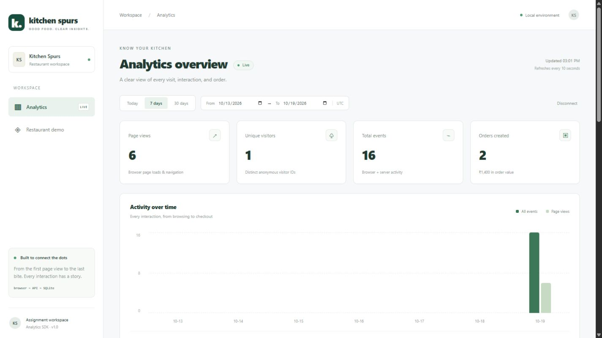
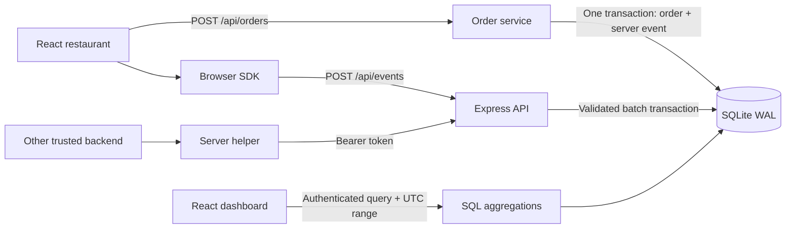

# Kitchen Spurs · Analytics SDK & Dashboard

A working restaurant demo with reusable browser and server SDKs, event ingestion, SQLite persistence, and a React analytics dashboard.

**Repository:** https://github.com/dileepmaurya800/Kitchen-Spurs

## Demonstration video

**[▶ Watch online — no sign-in or download required](https://dileepmaurya800.github.io/Kitchen-Spurs/)**

4 min 05 sec. Shows restaurant interactions, order creation, dashboard reporting, date filtering, and the main engineering decisions. Edited live browser capture with synthetic narration and English subtitles.

[](https://dileepmaurya800.github.io/Kitchen-Spurs/)

[Download MP4](https://dileepmaurya800.github.io/Kitchen-Spurs/media/demonstration.mp4) · [Read the transcript](docs/VIDEO-TRANSCRIPT.md)

Built by **Dileep Maurya · Senior Software Engineer · 5+ years of experience**. AI tools assisted implementation and verification. The engineering decisions and limitations below describe the submitted system.

## Run locally

Requires **Node.js 24.x** and npm. No PHP, Docker, database service, or database credentials required. Node 24's built-in `node:sqlite` provides SQLite; its API is experimental in that release line.

```sh
npm ci
npm run dev
```

Open **http://localhost:3000** for the restaurant and **http://localhost:3000/dashboard** for analytics. Enter `local-review-token` to connect. Development serves React and the API on the same port through Vite middleware.

The database is created automatically at `data/analytics.sqlite`. Start with an empty database to see only your interactions. Browse **Discover → Our menu → Our story**, add an item, and place an order. The browser flushes every three seconds; the dashboard refreshes every ten seconds. Dashboard navigation itself is deliberately excluded from page tracking.

For a production build served locally:

```sh
npm run build
npm start
```

Optional sample traffic:

```sh
npm run seed
```

Seeding inserts approximately one week of **synthetic browser activity**, marked with `properties.synthetic = true`. It creates no fake orders. It is opt-in, counts toward dashboard totals, and repeated runs add more events. The committed screenshots show real manual demo interactions without seeds. The database and local credentials are excluded from Git.

Optional configuration: copy `.env.example` to `.env` (`Copy-Item .env.example .env` in PowerShell, `cp .env.example .env` on macOS/Linux). Restart after changes; rebuild for any `VITE_` variable changes.

| Variable | Local default | Purpose |
| --- | --- | --- |
| `PORT` | `3000` | HTTP port |
| `HOST` | `127.0.0.1` | Bind only to the local machine |
| `DATABASE_PATH` | `data/analytics.sqlite` | Persistent database file |
| `DASHBOARD_TOKEN` | `local-review-token` | Private read credential |
| `SERVER_TRACKING_KEY` | `local-server-key` | Private server ingest credential |
| `PUBLIC_WRITE_KEY` | `kitchen-demo-public` | Public browser project identifier |
| `VITE_PUBLIC_WRITE_KEY` | `kitchen-demo-public` | Browser copy of the public key; must match `PUBLIC_WRITE_KEY` |
| `ALLOWED_ORIGINS` | `http://localhost:3000,http://127.0.0.1:3000` | Exact comma-separated browser origins |

If you change the port, update allowed origins too. Demo credentials are intentionally discoverable for local review. **Before hosting**, replace private tokens with long random secrets, set exact allowed origins, use HTTPS and a persistent database volume, and put the dashboard behind proper user authentication. This submission does not claim production readiness.

## Verification

```sh
npm test
npm run build
```

Tests use Node's test runner, temporary SQLite databases, real local HTTP servers, and isolated browser SDK environments. No running application is required. Tests cover deduplication, atomic batch rejection, authorization, origin checks, input size and timestamps, order idempotency and pricing, transactional rollback, UTC date boundaries, unique counts, throttling, server retry behavior, browser retry and beacon behavior, storage failure, opt-out, session expiry, and persistence across restart. GitHub Actions runs tests and the build on Node 24.

Manual browser verification: navigated between restaurant pages, added menu items, created an order, authenticated to analytics, and verified page counts, visitor count, order value, browser/server event sources, date filtering, and desktop/mobile layouts. See [demo steps](docs/DEMO.md) and [captures](docs/media/).

## Architecture



One application owns ingestion, business orders, and reporting. This keeps the demo easy to run and gives the order service an atomic delivery boundary. The same trusted event insertion path is used by `/api/server-events` and by the order transaction. Orders intentionally do **not** make a loopback HTTP call to the server helper: doing so would introduce a failure between saving the order and sending its event. An external application can use the helper independently.

| Directory | Responsibility |
| --- | --- |
| `sdk/browser.js` | Framework-independent browser tracker, queue, identities, retries, beacon and opt-out |
| `sdk/server.js` | Framework-independent Node helper with authenticated HTTP delivery |
| `server/app.js` | HTTP contracts, origin controls, authentication, rate and payload limits |
| `server/validation.js` | Event validation and canonical timestamps |
| `server/store.js` | Schema, prepared SQL, transactions, menu pricing and reporting |
| `src/` | React restaurant and dashboard |
| `tests/` | SDK, HTTP and persistence tests |

## SDK integration

### Browser (React, any SPA, or plain JavaScript)

Copy/import `sdk/browser.js` into your application and initialize **one instance** per storage prefix. Nothing in the browser configuration is secret.

```js
import { createAnalytics } from './sdk/browser.js';

const analytics = createAnalytics({
  endpoint: 'http://localhost:3000/api/events',
  writeKey: 'kitchen-demo-public',
  enabled: true, // In production, use your consent decision.
  onError: error => console.warn('Analytics delivery:', error.message)
});

analytics.page(); // Current pathname, with query and fragment removed.
analytics.track('add_to_cart', { itemId: 'bowl', category: 'Bowls' });

// Call once after each actual SPA route change; the SDK doesn't patch history.
analytics.page('/menu');

// Associate a backend business action with the same anonymous identity.
const { visitorId, sessionId } = analytics.identity();

await analytics.flush(); // An attempt, not a delivery receipt; failures invoke onError.
analytics.setEnabled(false); // Stop capture and discard unsent queued events.
analytics.destroy(); // Clear timer/listeners when the owning application unmounts.
```

The demo calls `page()` from its React route effect and tracks `menu_filtered`, `add_to_cart`, and `checkout_started`. `order_created` is reserved for trusted server ingestion. The restaurant's browser consent switch persists across reloads; business order records and their server events still exist when browser tracking is disabled.

Browser delivery batches up to 50 events, flushes every three seconds or at 20 pending events, and uses a five-second timeout. A session-storage queue holds at most 200 events; overflow drops the oldest. Network, 429, and 5xx failures retain IDs and back off with jitter up to roughly 60 seconds. An `online` event retries immediately. Page hiding attempts `sendBeacon` for up to ten events under 60KB; pending events remain until an acknowledged fetch, so replays are safe. The beacon uses `text/plain` JSON and the same validation/authentication path. Permanent 400/401/403/413 responses discard the rejected batch and invoke `onError`, preventing infinite poison-batch retries. A batch containing one malformed event can therefore lose other events in that batch.

Queue recovery lasts through reloads in the same tab, up to the seven-day ingestion window. Storage failures fall back to memory. Closing the tab, clearing storage, exhausted capacity, ad blockers, and process termination can lose browser events. This is **best-effort delivery with idempotent persistence**, not a promise of lossless analytics.

### Server

```js
import { createServerTracker } from './sdk/server.js';

const tracker = createServerTracker({
  endpoint: 'http://localhost:3000/api/server-events',
  apiKey: process.env.SERVER_TRACKING_KEY
});

try {
  await tracker.track('reservation_requested', {
    visitorId: 'anonymous-visitor-id',
    sessionId: 'anonymous-session-id', // Optional for server events.
    properties: { seats: 2 }
  });
} catch (error) {
  // Log/alert or persist to your application's durable retry mechanism.
  console.error(error);
}
```

The helper generates one event ID before its first attempt, uses five-second request timeouts, retries network/429/5xx failures at most three times after the first attempt, and fails immediately on other 4xx responses. It rejects after exhausted retries; the caller must handle that outcome. For durable retries across process restarts, supply a persisted `id` and `occurredAt` and use an outbox in the host application's business transaction. This helper deliberately does not pretend an in-memory retry loop is durable.

## Event and identity model

```json
{
  "id": "ccbb4c93-45d1-4960-a739-962927c969d7",
  "name": "page_view",
  "visitorId": "anonymous-stable-browser-uuid",
  "sessionId": "anonymous-session-uuid",
  "path": "/menu",
  "occurredAt": "2026-10-19T09:00:00.000Z",
  "properties": {}
}
```

- Event IDs are random UUIDs. `events.id` is the primary key; repeated delivery inserts once. ID collisions use first-write-wins. SDK retries reuse the same ID.
- `visitorId` is a random browser-profile identifier persisted in local storage. Unique visitors means distinct submitted visitor IDs in the selected range across browser and server sources. It does not mean people, accounts, or devices. Clearing storage or using another browser changes identity. IDs are untrusted inputs, not authorization.
- A session ID lives in session storage and rotates after 30 minutes of inactivity measured when an identity is requested. Tabs have separate session state. No cross-device linking, fingerprinting, login identity merging, or session metrics are implemented.
- `source` and `received_at` are assigned by the server, never trusted from a browser payload. No IP address or user-agent is persisted. Query strings and fragments are stripped by `page()` and rejected by ingestion.
- Names use lowercase letters, digits and underscores (max 64 characters). IDs use 8–100 alphanumeric/underscore/hyphen characters. Properties are a JSON object up to 4KB as measured by serialized JS string length. The 256KB body limit is an additional byte limit.
- Ingest accepts event times from seven days ago through five minutes ahead, normalizes to UTC ISO timestamps, and stores receipt time separately. Reports use **occurrence time**, so delayed deliveries can change historical totals. Clock skew within the allowance is accepted.
- Do not send names, emails, addresses, freeform user content, or sensitive data in properties. The demo doesn't collect those fields. There is no generic PII scrubbing service.

## API

All JSON, one local project. Error responses use `{ "error": "message" }`.

| Method and route | Credential | Contract |
| --- | --- | --- |
| `GET /api/health` | None | `{status:"ok"}` |
| `GET /api/menu` | None | Menu and authoritative integer INR prices |
| `POST /api/events` | Public `X-Write-Key` or body `writeKey` | `{events:[...]}`; 1–50 validated browser events; 202 `{accepted,received}` |
| `POST /api/server-events` | `Authorization: Bearer <SERVER_TRACKING_KEY>` | Same event envelope; trusted server source; 202 |
| `POST /api/orders` | None; local demo business endpoint | `Idempotency-Key` header; body `{visitorId,sessionId,items:[{id,quantity}]}` |
| `GET /api/analytics?from=YYYY-MM-DD&to=YYYY-MM-DD` | `Authorization: Bearer <DASHBOARD_TOKEN>` | Summary, daily totals, top pages, event breakdown, latest 15 events |

Order creation returns 201 `{id,total,replayed:false}`; matching replay returns 200 with the same order and `replayed:true`. Reusing an order key with a different visitor or item payload returns 409. The client retains the order key across network retries while the page remains mounted. Editing the cart begins a new request. A reload loses the pending key: this demo has no durable checkout recovery or payment flow.

Order item IDs must exist; quantities are integers 1–20, with no duplicate item IDs and no more than 20 lines. Prices are looked up on the server; client prices are ignored. Prices and totals are integer **whole INR rupees** for this menu. A general commerce implementation should use minor currency units and explicit currency metadata.

Responses: 400 invalid payload/date range, 401 credential failure, 403 disallowed origin, 409 changed idempotency payload, 413 oversized body, 429 rate limit (`Retry-After: 60`), 500 internal error without stack details.

Date filters are inclusive UTC calendar dates, implemented as `occurred_at >= from midnight AND occurred_at < midnight after to`, up to 366 inclusive days. Reversed and invalid calendar dates are rejected. Page views count browser `page_view`; trusted order metrics count server `order_created`. The dashboard fills missing days with zero, excludes its own navigation, and shows empty/error states.

## Database and correctness

| Table | Columns and constraints |
| --- | --- |
| `events` | `id TEXT PRIMARY KEY`, `name`, `source CHECK(browser/server)`, `visitor_id`, nullable `session_id`, nullable `path`, `occurred_at`, `received_at`, JSON `properties` |
| `orders` | `id TEXT PRIMARY KEY`, unique `idempotency_key`, `visitor_id`, integer `total`, JSON `items`, `created_at` |

All required fields are `NOT NULL`. Indexes cover `(occurred_at,name)` and `(visitor_id,occurred_at)`. SQL is parameterized; event names, date strings, and properties never become SQL fragments. SQLite runs with WAL and a five-second busy timeout. Each valid batch is inserted in one `BEGIN IMMEDIATE` transaction. Validation runs across the complete batch before insertion. A duplicate event is an accepted replay, rather than a validation error.

The order and its `order_created` event are committed in **the same database transaction**. A failed analytics insert rolls back the order. This gives atomic local persistence; it does not describe a distributed exactly-once delivery protocol. If the response is lost after commit, retrying the order with its original key returns the existing result without creating a second event.

## Decisions, tradeoffs, and limitations

1. **Node/Express instead of Laravel:** Node 24 was available in the development environment; PHP/Composer were not. One language makes SDK reuse and reviewer setup straightforward. The contracts and schema are transferable to Laravel.
2. **SQLite instead of a database service:** Real durable storage with no setup burden. Synchronous SQL blocks Node's event loop, and one writer limits throughput. This is appropriate for a local demonstration, not high-volume telemetry. At scale, use a durable ingestion queue, workers, PostgreSQL or an analytics store, partitioning, and preaggregated reports.
3. **Transactional local business tracking:** Simpler and stronger than HTTP dual writes inside this process. If the business system moves to another database, use an outbox plus idempotent consumers.
4. **Public ingestion is inherently untrusted:** A browser write key is a project identifier, not a secret. Origin checks restrict cooperating browsers; non-browser clients can spoof origins and visitor IDs. Browser traffic can be inflated. Only authenticated server ingestion may claim `order_created`.
5. **Single-tenant local authentication:** Separate fixed private tokens protect reports and server ingest. No users, roles, token rotation UI, organization isolation, or audit trail. Dashboard credentials are kept in tab session storage and are exposed to any successful same-origin XSS. There are no third-party scripts or remote fonts.
6. **Bounded abuse protection:** 120 API requests per IP per minute, 256KB request bodies, 50-event batches, 4KB properties, and 366-day report ranges. Limits are per process; they do not survive restart or coordinate across replicas. `trust proxy` is off. A deployment behind a proxy needs an explicit trusted-proxy configuration and a shared limiter. Authentication and CORS do not replace DDoS controls.
7. **Simple aggregates:** Reports run directly on indexed raw events, with top-10 pages, top-20 event/source groups and 15 recent events. They are separate SQL queries without a reporting snapshot, acceptable for this single-process demo. No pagination, funnels, attribution, bots filtering, revenue refunds, or identity reconciliation.
8. **Privacy and retention:** Demo browser analytics defaults on with a persistent opt-out; production consent requirements need a deployment-specific design. Opt-out drops queued browser events but does not delete already stored data, anonymous identifiers, or necessary business records. No automated retention/deletion, data export, or consent audit is implemented.
9. **Operational scope:** No load-test claim, deployment hosting, backups, alerting, metrics pipeline, versioned migrations, or automatic cleanup. Schema creation is idempotent for this initial version. Back up the SQLite database using a SQLite-aware backup process, including WAL consistency.
10. **Checkout scope:** Demo orders are anonymous and unauthenticated, contain no payment/customer data, and are not a production order API. Add real user authorization, fraud protection, CSRF design appropriate to the auth model, persistent client idempotency, and payment reconciliation before commercial use.

## Submission materials

- Repository: https://github.com/dileepmaurya800/Kitchen-Spurs
- [Demo walkthrough and technical explanation script](docs/DEMO.md)
- [Personal introduction outline](docs/INTRODUCTION.md)
- [Verification notes](docs/VERIFICATION.md)

The [demonstration video](https://dileepmaurya800.github.io/Kitchen-Spurs/) shows real browser interactions, order creation, dashboard reporting and date filtering, followed by the main engineering decisions. It uses synthetic narration and includes English subtitles. A [transcript](docs/VIDEO-TRANSCRIPT.md) and [MP4 download](docs/media/demonstration.mp4) are included. A personal introduction recording is not included; that remains a separate recording in the candidate's own voice.

## References

- [Node 24 SQLite API](https://nodejs.org/docs/latest-v24.x/api/sqlite.html)
- [Vite setup and build documentation](https://vite.dev/guide/)
